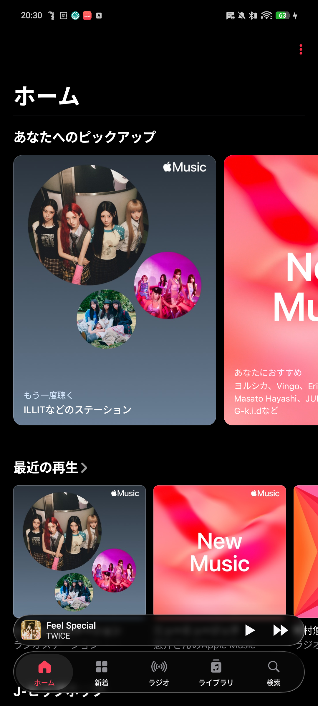
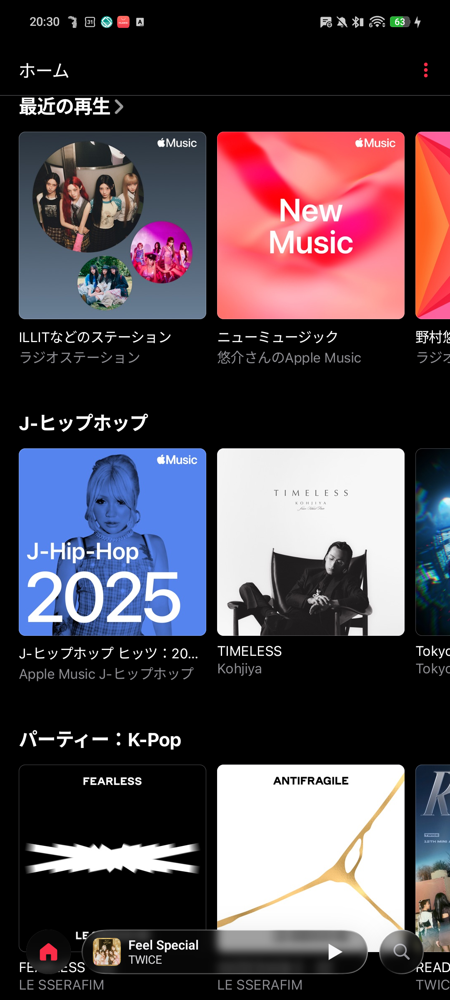
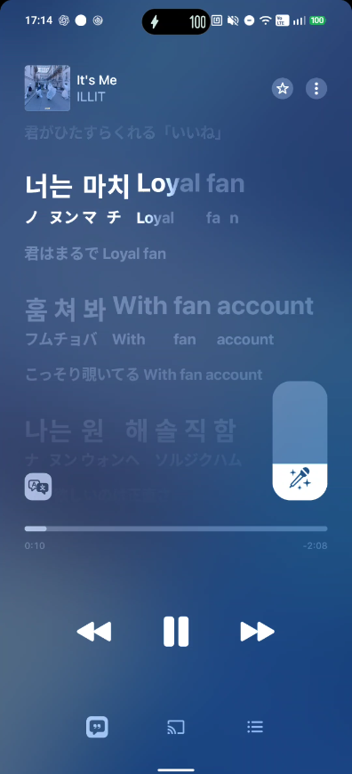
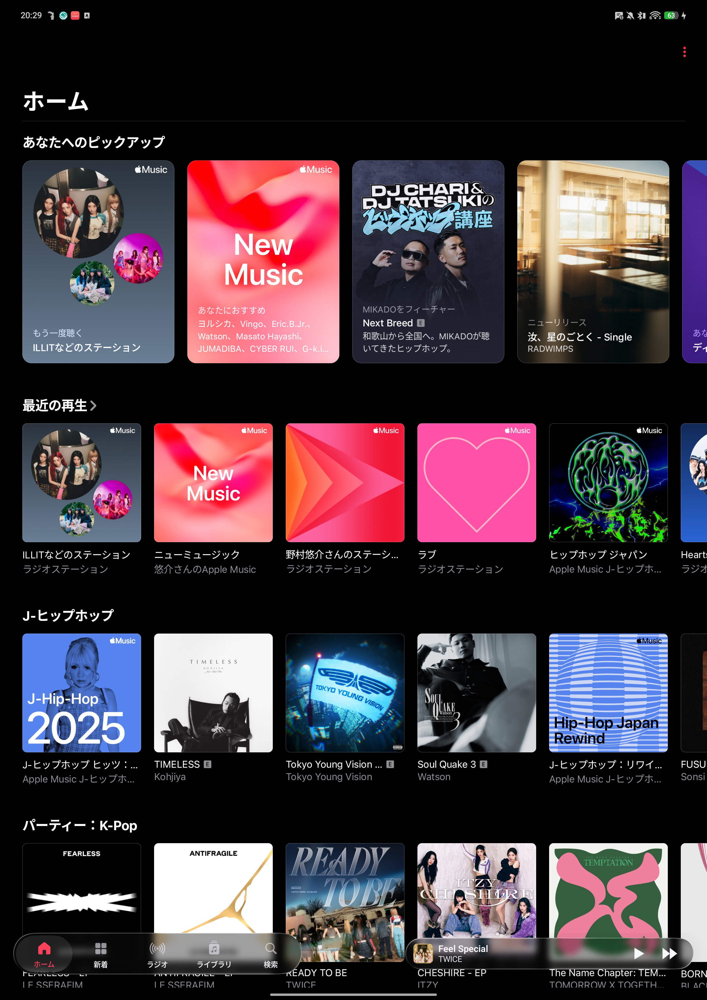
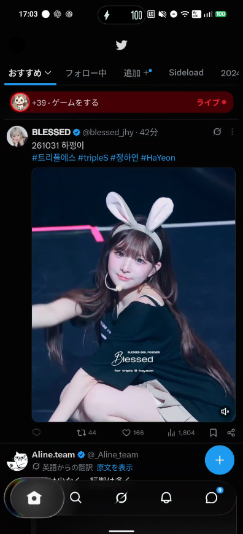
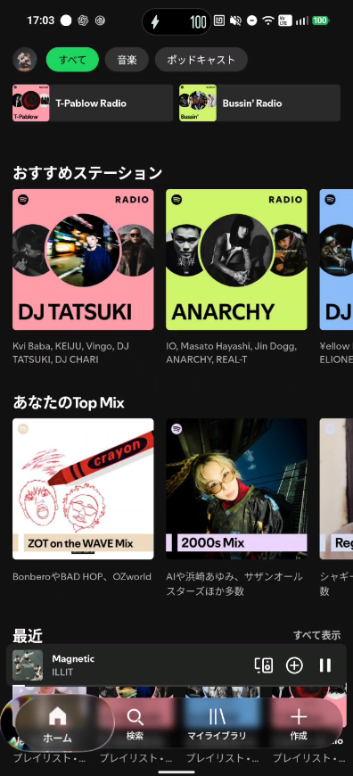
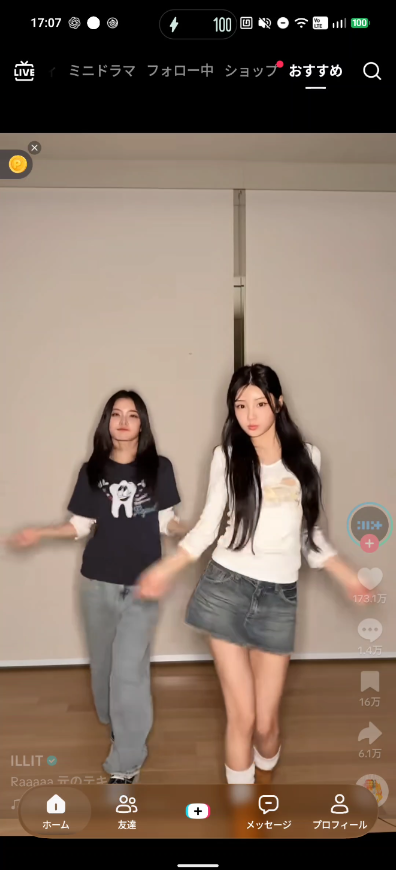
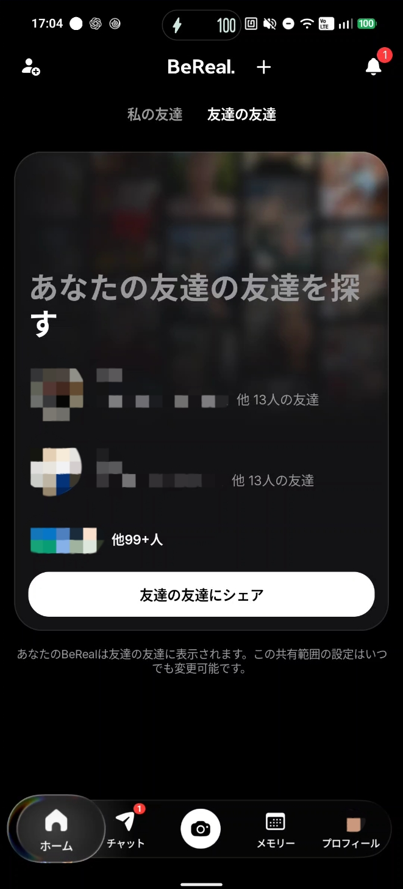

# LiquidBottom

[English](README.md) | [日本語](README.ja.md)

Android アプリのボトムバーを、リアルタイムに背景を屈折・透過する **Liquid Glass** ドックへ置き換える LSPosed モジュールです。Apple Music の **Sing**（ボーカル音量調整・カラオケ機能）にも対応しています。

## スクリーンショット

### Apple Music

| Stacked (Phone) | Compact (Scroll) | Apple Music Sing | Side-by-Side (Tablet) |
| :---: | :---: | :---: | :---: |
|  |  |  |  |

### X / Spotify / TikTok / BeReal.

| X | Spotify | TikTok | BeReal. |
| :---: | :---: | :---: | :---: |
|  |  |  |  |

## 対応アプリ

- **Apple Music** (`com.apple.android.music`)
  - **Apple Music Sing** に対応（オンデバイスでのリアルタイムボーカル分離・純正歌詞画面のマイクスライダー操作）。
- **X** (`com.twitter.android`)
- **Spotify** (`com.spotify.music`)
- **TikTok** (`com.ss.android.ugc.trill`)
- **BeReal.** (`com.bereal.ft`)
  - ※ **BeReal.** のみ、[BeFuck](https://github.com/tqmane/befuck) の併用が必須です（必ず併用してください）。
