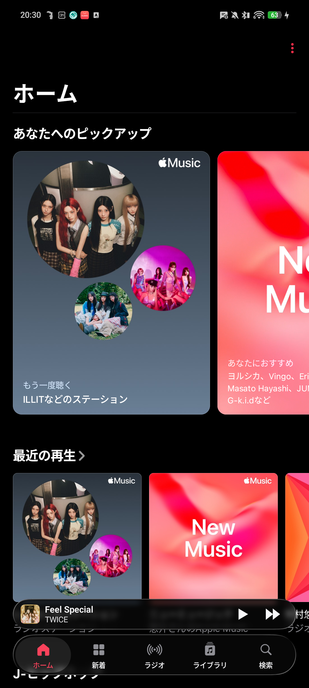
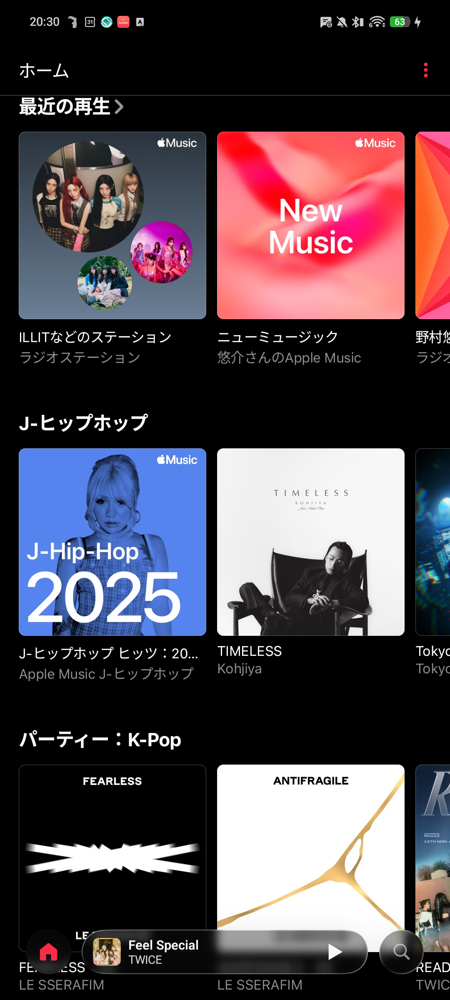
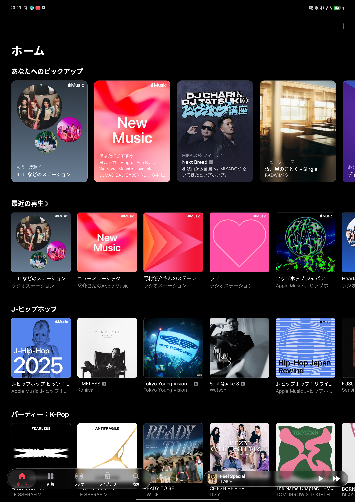

# LiquidBottom

[English](README.md) | [日本語](README.ja.md)

Android アプリのボトムバーを、リアルタイムに背景を屈折・透過する **Liquid Glass** ドックへ置き換える LSPosed モジュールです。

## スクリーンショット

| Stacked (Phone) | Compact (Scroll) | Side-by-Side (Tablet) |
| :---: | :---: | :---: |
|  |  |  |

## 対応アプリ

- **Apple Music** (`com.apple.android.music`)
