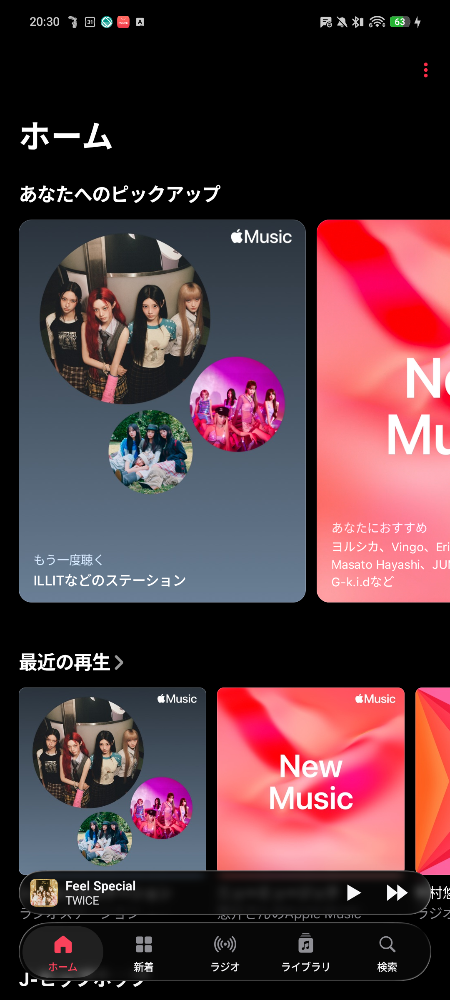
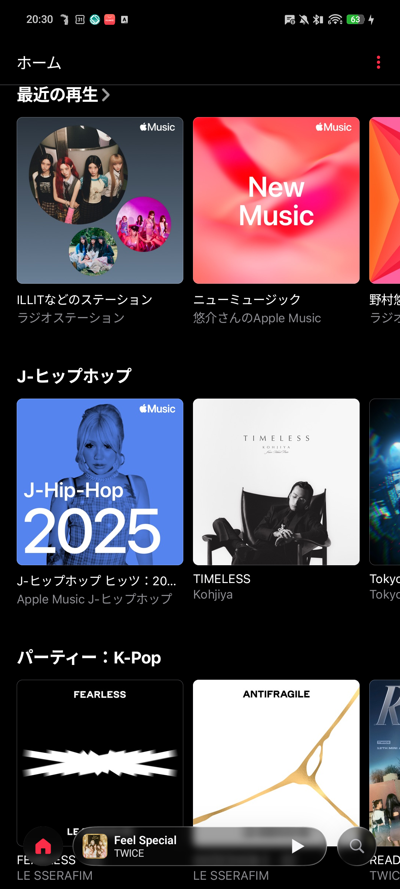
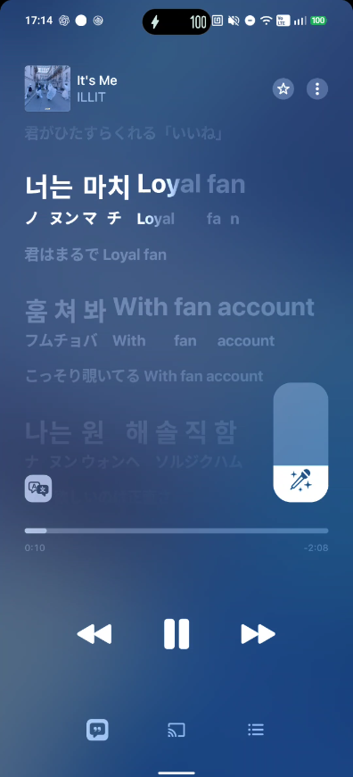
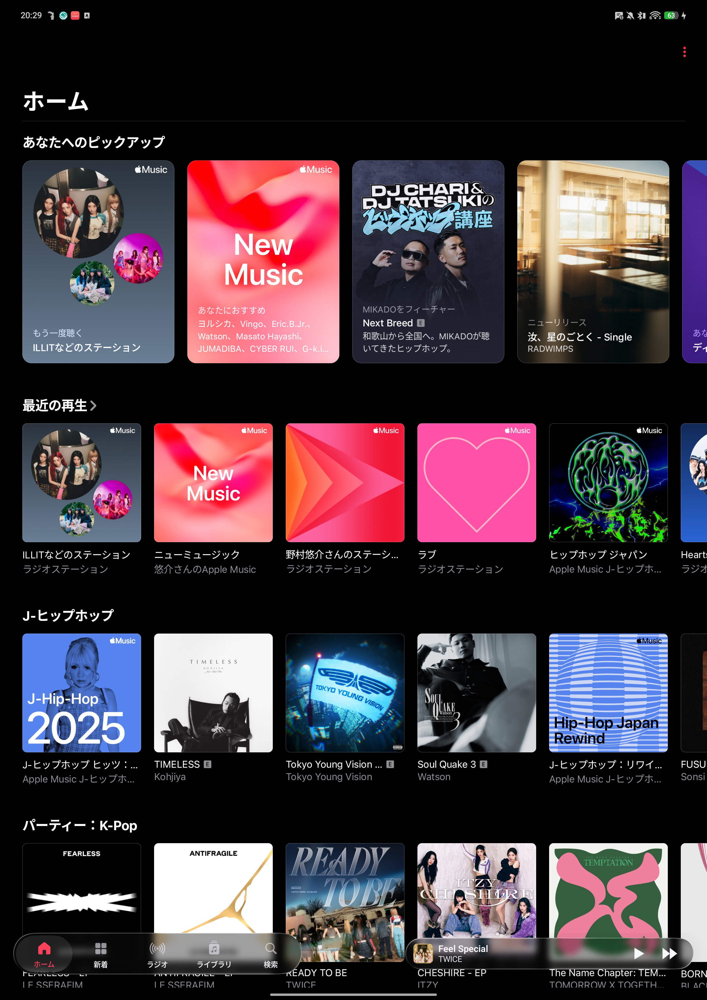
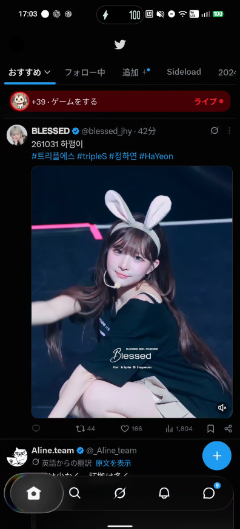
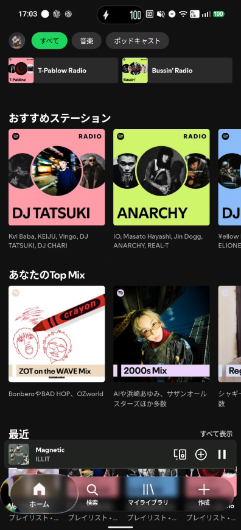
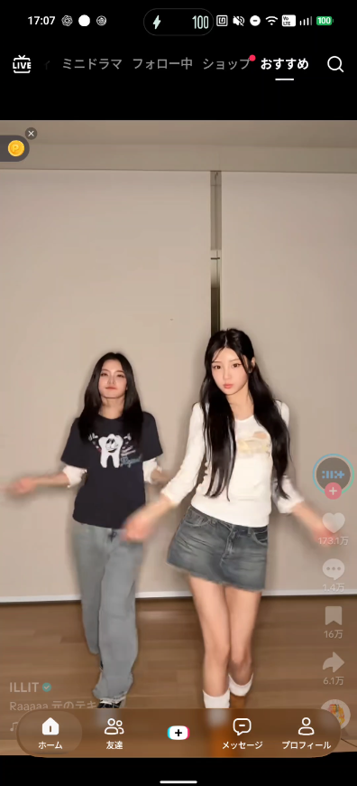
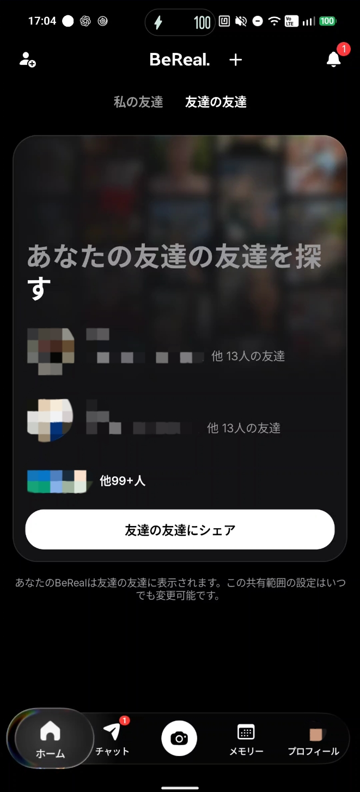

# LiquidBottom

[English](README.md) | [日本語](README.ja.md)

An LSPosed module that replaces Android app bottom navigation bars with a real-time refractive **Liquid Glass** dock, and brings **Apple Music Sing** support to Android.

## Screenshots

### Apple Music

| Stacked (Phone) | Compact (Scroll) | Apple Music Sing | Side-by-Side (Tablet) |
| :---: | :---: | :---: | :---: |
|  |  |  |  |

### X / Spotify / TikTok / BeReal.

| X | Spotify | TikTok | BeReal. |
| :---: | :---: | :---: | :---: |
|  |  |  |  |

## Supported Apps

- **Apple Music** (`com.apple.android.music`)
  - Supports **Apple Music Sing** (on-device real-time vocal adjustment with native lyric view mic slider controls).
- **X** (`com.twitter.android`)
- **Spotify** (`com.spotify.music`)
- **TikTok** (`com.ss.android.ugc.trill`)
- **BeReal.** (`com.bereal.ft`)
  - **Note:** BeReal. requires [BeFuck](https://github.com/tqmane/befuck) to be used together.
